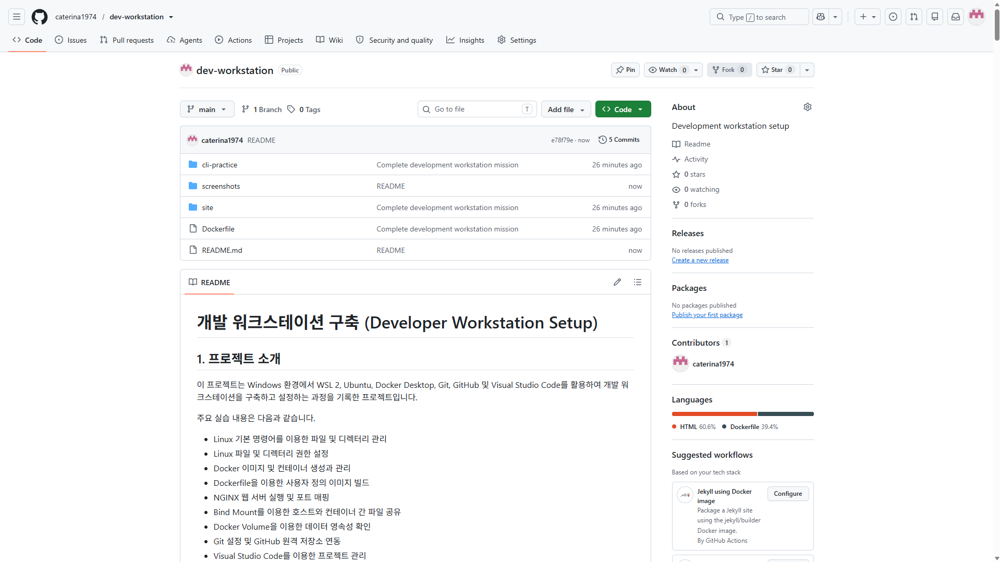

# 개발 워크스테이션 구축 (Developer Workstation Setup)

## 1. 프로젝트 소개

이 프로젝트는 Windows 환경에서 WSL 2, Ubuntu, Docker Desktop, Git, GitHub 및 Visual Studio Code를 활용하여 개발 워크스테이션을 구축하고 설정하는 과정을 기록한 프로젝트입니다.

주요 실습 내용은 다음과 같습니다.

- Linux 기본 명령어를 이용한 파일 및 디렉터리 관리
- Linux 파일 및 디렉터리 권한 설정
- Docker 이미지 및 컨테이너 생성과 관리
- Dockerfile을 이용한 사용자 정의 이미지 빌드
- NGINX 웹 서버 실행 및 포트 매핑
- Bind Mount를 이용한 호스트와 컨테이너 간 파일 공유
- Docker Volume을 이용한 데이터 영속성 확인
- Git 설정 및 GitHub 원격 저장소 연동
- Visual Studio Code를 이용한 프로젝트 관리
- 개발 환경 구축 과정에서 발생한 오류와 해결 방법 기록

**GitHub 저장소:** [caterina1974/dev-workstation](https://github.com/caterina1974/dev-workstation)

## 2. 개발 환경

| 구성 요소 | 버전 및 설정 |
|---|---|
| 운영체제 | Windows |
| Linux 환경 | WSL 2 |
| Linux 배포판 | Ubuntu 24.04.5 LTS |
| 셸 | Bash |
| Docker CLI | 29.9.2 |
| Docker Desktop | 4.97.0 |
| Git | 2.43.0 |
| GitHub CLI | 2.103.3 |
| 아키텍처 | AMD64 |

### 개발 환경 확인

다음 명령어를 사용하여 개발 환경을 확인했습니다.

```bash
cat /etc/os-release
echo $SHELL
docker --version
git --version
gh --version
docker version
docker info
```

Docker Desktop의 WSL Integration을 활성화하여 Ubuntu 환경에서 Docker를 사용할 수 있도록 설정했습니다.

### Docker 데몬 및 서버 상태 확인

`docker --version`은 Docker CLI 버전을 확인하고, `docker version` 및 `docker info`는 클라이언트와 서버(데몬)의 연결 및 정보를 확인합니다. 다음 명령어로 서버 정보를 핵심 항목 위주로 확인할 수 있습니다.

```bash
docker version
docker info | sed -n '1,35p'

docker info --format 'Server Version: {{.ServerVersion}}'
docker info --format 'Operating System: {{.OperatingSystem}}'
docker info --format 'Architecture: {{.Architecture}}'
docker info --format 'CPUs: {{.NCPU}}'
```

Docker Desktop이 실행 중이고 WSL Integration이 정상적으로 연결되어 있다면 서버 버전과 운영체제 정보가 출력됩니다. 실제 평가 증빙에는 본인 환경에서 실행한 출력 결과를 함께 기록합니다.

## 3. Linux 기본 명령어 실습

Ubuntu 터미널에서 기본적인 디렉터리 이동과 파일 관리 명령어를 실습했습니다.

### 현재 위치 및 파일 목록 확인

```bash
pwd
ls
ls -la
```

- `pwd`: 현재 작업 디렉터리의 경로를 확인합니다.
- `ls`: 현재 디렉터리의 파일과 폴더 목록을 표시합니다.
- `ls -la`: 숨김 파일을 포함하여 파일과 폴더의 상세 정보를 표시합니다.

### 파일 및 디렉터리 생성

```bash
mkdir cli-practice
cd cli-practice

touch notes.txt
echo "My Development Workstation" > notes.txt

cat notes.txt
```

- `mkdir`: 새로운 디렉터리를 생성합니다.
- `touch`: 빈 파일을 생성합니다.
- `echo`: 문자열을 출력하거나 파일에 기록합니다.
- `cat`: 파일의 내용을 확인합니다.

### 파일 복사, 이동, 이름 변경 및 삭제

```bash
cp notes.txt backup.txt

mkdir archive

mv backup.txt archive/

mv archive/backup.txt archive/final.txt

rm archive/final.txt

ls -la archive
```

위 명령어를 통해 파일 복사, 이동, 이름 변경 및 삭제 작업을 수행했습니다.

명령 실행 결과를 본문에 기록할 때는 다음 명령어로 파일 상태를 다시 확인합니다.

```bash
printf '\n[notes.txt 내용]\n'
cat notes.txt
printf '\n[archive 디렉터리]\n'
ls -la archive
printf '\n[현재 디렉터리의 파일]\n'
ls -la
```

`archive/` 안의 `final.txt`를 삭제한 이후에는 해당 파일이 목록에 남아 있지 않은지 확인합니다. 제출할 때는 위 명령어의 실제 출력 결과를 복사하여 이 절의 실행 결과로 추가합니다.

### 파일 내용 확인

```bash
pwd
cat notes.txt
cat ~/dev-workstation/cli-practice/notes.txt
```

상대 경로와 절대 경로를 사용하여 파일의 내용을 확인했습니다.

## 4. Linux 파일 및 디렉터리 권한 설정

Linux의 `chmod` 명령어를 사용하여 파일과 디렉터리의 접근 권한을 변경했습니다.

### 파일 및 디렉터리 생성

```bash
touch permission-file.txt
mkdir permission-dir
```

### 초기 권한 설정

```bash
chmod 600 permission-file.txt
chmod 700 permission-dir

echo "BEFORE PERMISSION CHANGE"

ls -l permission-file.txt
ls -ld permission-dir
```

실행 결과:

```text
-rw------- permission-file.txt
drwx------ permission-dir
```

소유자와 그룹 정보를 포함한 상세 권한은 다음 명령어로 확인합니다.

```bash
id
stat -c 'Before: owner=%U group=%G mode=%a file=%n' permission-file.txt
stat -c 'Before: owner=%U group=%G mode=%a file=%n' permission-dir
```

### 권한 변경

```bash
chmod 644 permission-file.txt
chmod 755 permission-dir

echo "AFTER PERMISSION CHANGE"

ls -l permission-file.txt
ls -ld permission-dir
```

실행 결과:

```text
-rw-r--r-- permission-file.txt
drwxr-xr-x permission-dir
```

권한 변경 후 소유자, 그룹, 권한을 다시 확인합니다.

```bash
stat -c 'After: owner=%U group=%G mode=%a file=%n' permission-file.txt
stat -c 'After: owner=%U group=%G mode=%a file=%n' permission-dir
```

`chmod`는 접근 권한만 변경하며 파일의 소유자와 그룹은 변경하지 않습니다. 소유자 또는 그룹 변경이 필요한 경우에만 `chown`을 사용합니다. 실제 제출 자료에는 `id`와 `stat`의 실행 결과를 함께 첨부하여 권한 변경 전후를 비교합니다.

### Linux 권한의 의미

Linux의 파일 및 디렉터리 권한은 소유자(Owner), 그룹(Group), 기타 사용자(Others) 세 가지 범주로 구분됩니다.

| 권한 | 의미 | 숫자 |
|---|---|---:|
| Read (r) | 파일 읽기 또는 디렉터리 목록 확인 | 4 |
| Write (w) | 파일 수정 또는 디렉터리 내 항목 변경 | 2 |
| Execute (x) | 파일 실행 또는 디렉터리 접근 | 1 |

주요 권한 설정의 의미와 실습에서 해당 권한을 선택한 이유는 다음과 같습니다.

| 권한 | 설명 | 사용 이유 |
|---|---|---|
| `600` | 소유자만 읽기 및 쓰기 가능 | 개인 파일처럼 다른 사용자의 열람을 제한해야 하는 파일에 적합 |
| `700` | 소유자만 읽기, 쓰기 및 실행 가능 | 소유자 외 사용자의 디렉터리 접근을 제한할 때 적합 |
| `644` | 소유자는 읽기 및 쓰기 가능, 나머지는 읽기 가능 | 일반 문서나 공개적으로 읽혀야 하는 파일에 적합 |
| `755` | 소유자는 모든 권한을 가지며, 나머지는 읽기 및 실행 가능 | 다른 사용자도 디렉터리를 탐색하거나 공개 파일을 읽어야 할 때 적합 |

권한은 필요한 최소 범위로 부여하는 것이 원칙입니다. 특별한 이유가 없다면 모든 사용자에게 읽기·쓰기·실행을 허용하는 `777`은 사용하지 않습니다. 디렉터리의 실행 권한(`x`)은 디렉터리 내부를 탐색하고 접근할 수 있는 권한을 의미합니다.

## 5. Docker 설치 및 작동 확인

Docker Desktop과 WSL 2를 연동하여 Ubuntu 터미널에서 Docker를 사용할 수 있도록 설정했습니다.

### Docker 버전 확인

```bash
docker --version
```

확인된 버전:

```text
Docker version 29.9.2
```

### Docker 실행 환경 확인

```bash
docker version
docker info
```

Docker 클라이언트 및 서버 정보를 확인하기 위해 위 명령어를 사용했습니다.

서버 정보 중 실제로 확인한 항목을 간단히 기록하려면 다음 명령어를 사용할 수 있습니다.

```bash
docker info | sed -n '1,35p'
```

위 명령의 실제 출력은 Docker Desktop 버전과 실행 환경에 따라 달라질 수 있으므로, 제출 시 본인 컴퓨터에서 실행한 결과를 붙여 넣습니다.

초기 확인 과정에서 Docker Socket 접근 권한 오류가 발생했지만, 이후 사용자 그룹 권한을 적용하고 WSL 세션을 재시작하여 문제를 해결했습니다.

### Hello World 컨테이너 실행

```bash
docker run --rm hello-world
```

실행 결과:

```text
Hello from Docker!

This message shows that your installation appears to be working correctly.
```

`hello-world` 이미지가 정상적으로 다운로드되고 컨테이너가 실행되는 것을 확인했습니다.

평가 증빙을 위해 실행 로그 전체를 파일로 저장하고 확인할 수 있습니다.

```bash
docker run --rm hello-world 2>&1 | tee hello-world.log
cat hello-world.log
```

`hello-world.log`의 실제 전체 내용을 이 README에 코드 블록으로 추가하면 실행 증빙을 본문에서도 확인할 수 있습니다. 로그 내용은 설치된 이미지 버전과 실행 환경에 따라 달라질 수 있으므로 임의의 출력 대신 실제 실행 결과를 사용합니다.

이를 통해 Docker 클라이언트가 Docker 데몬과 통신하고 컨테이너를 실행할 수 있음을 확인했습니다.

## 6. Docker 컨테이너 생성 및 관리

Ubuntu 이미지를 이용하여 대화형 컨테이너와 백그라운드 컨테이너를 실행했습니다.

### 대화형 Ubuntu 컨테이너 실행

```bash
docker run -it --name mission-ubuntu-interactive ubuntu:24.04 bash
```

컨테이너 내부에서 다음 명령어를 실행했습니다.

```bash
exit
```

컨테이너 종료 후 상태를 확인했습니다.

```bash
docker ps -a --filter name=mission-ubuntu-interactive
```

컨테이너가 `Exited (0)` 상태로 종료된 것을 확인했습니다.

### 백그라운드 컨테이너 실행

```bash
docker run -d \
  --name mission-ubuntu-background \
  ubuntu:24.04 sleep infinity
```

`-d` 옵션을 사용하여 컨테이너를 백그라운드에서 실행했습니다.

### 실행 중인 컨테이너 내부에 접속

```bash
docker exec -it mission-ubuntu-background bash
```

컨테이너 내부에서 다음 명령어를 실행했습니다.

```bash
echo "Testing Docker exec"
exit
```

컨테이너 실행 상태를 확인했습니다.

```bash
docker ps --filter name=mission-ubuntu-background
```

### 컨테이너 중지 및 상태 확인

```bash
docker stop mission-ubuntu-background

docker ps -a --filter name=mission-ubuntu-background
```

컨테이너를 중지한 뒤에도 컨테이너 자체는 삭제되지 않고 종료 상태로 남아 있는 것을 확인했습니다.

### 주요 Docker 명령어

| 명령어 | 기능 |
|---|---|
| `docker run -it` | 대화형 컨테이너 생성 및 실행 |
| `docker run -d` | 컨테이너를 백그라운드에서 실행 |
| `docker exec -it` | 실행 중인 컨테이너 내부에 접속 |
| `docker stop` | 실행 중인 컨테이너 중지 |
| `docker ps` | 현재 실행 중인 컨테이너 확인 |
| `docker ps -a` | 종료된 컨테이너를 포함한 전체 목록 확인 |

### 이미지와 컨테이너의 차이

Docker **이미지(Image)**는 애플리케이션 실행에 필요한 코드, 라이브러리 및 설정을 담은 읽기 전용 템플릿입니다. Docker **컨테이너(Container)**는 이미지를 바탕으로 생성되어 실제로 실행되는 인스턴스입니다.

| 구분 | 이미지(Image) | 컨테이너(Container) |
|---|---|---|
| 역할 | 실행 환경의 템플릿 | 이미지를 실행한 인스턴스 |
| 생성·실행 | `docker build`로 이미지 빌드 | `docker run`으로 컨테이너 생성 및 실행 |
| 변경 | Dockerfile 또는 빌드 입력 파일을 수정한 뒤 다시 빌드 | 실행 중 변경한 파일은 컨테이너의 쓰기 가능 계층에 저장될 수 있음 |
| 삭제 | `docker rmi`로 이미지 삭제 | `docker rm`으로 컨테이너 삭제 |

컨테이너 안에서 변경한 데이터는 이미지 자체에 자동 반영되지 않습니다. 컨테이너의 쓰기 가능 계층에 저장된 변경사항은 컨테이너를 삭제하면 함께 사라질 수 있습니다. 이미지 내용을 변경하려면 Dockerfile 또는 빌드 입력 파일을 수정한 뒤 이미지를 다시 빌드하고 컨테이너를 재생성해야 합니다. 컨테이너를 삭제해도 유지해야 하는 데이터는 Bind Mount 또는 Docker Volume에 저장합니다.

```bash
# 이미지 빌드

docker build -t mission-web:1.0 .

# 이미지로 컨테이너 생성 및 실행
docker run -d --name mission-web-example -p 8082:80 mission-web:1.0

# 컨테이너 상태 확인
docker ps -a
```

### 컨테이너 및 이미지 목록의 실제 출력 확인

```bash
docker ps -a
docker images
```

위 두 명령의 결과에는 실행·종료된 컨테이너와 로컬 이미지가 표시됩니다. 실제 제출 시에는 본인 환경에서 실행한 출력 일부를 README 본문에 추가합니다.

## 7. Dockerfile을 이용한 사용자 정의 이미지 생성

NGINX를 기반으로 간단한 웹 서버 이미지를 생성했습니다.

### HTML 파일 생성

파일 경로: `site/index.html`

```html
<!DOCTYPE html>
<html lang="en">
<head>
    <meta charset="UTF-8">
    <title>My Development Workspace</title>
</head>
<body>
    <h1>Hello, Docker!</h1>
    <p>This is my first custom web server.</p>
</body>
</html>
```

### Dockerfile 작성

프로젝트 최상위 디렉터리에 `Dockerfile`을 생성했습니다.

```dockerfile
FROM nginx:alpine

LABEL org.opencontainers.image.title="my-custom-web"

ENV APP_ENV=development

COPY site/ /usr/share/nginx/html/

EXPOSE 80
```

### Dockerfile 주요 명령어

- `FROM nginx:alpine`: 경량 NGINX Alpine 이미지를 기반 이미지로 사용합니다.
- `LABEL`: 이미지에 메타데이터를 추가합니다.
- `ENV`: 컨테이너에서 사용할 환경 변수를 설정합니다.
- `COPY`: 호스트의 `site/` 디렉터리 내용을 컨테이너의 웹 서버 디렉터리에 복사합니다.
- `EXPOSE 80`: 컨테이너가 사용하는 웹 서버 포트를 명시합니다.

### 사용자 정의 Docker 이미지 빌드

```bash
docker build -t mission-web:1.0 .
```

빌드가 정상적으로 완료되어 `mission-web:1.0`이라는 사용자 정의 이미지가 생성되었습니다.

빌드 단계와 결과를 확인할 수 있도록 다음 명령어로 전체 빌드 로그를 저장합니다.

```bash
set -o pipefail
docker build --progress=plain -t mission-web:1.0 . 2>&1 | tee docker-build.log
```

빌드가 끝난 후 `docker-build.log`를 열어 실제 출력 내용을 확인하고, 주요 단계와 최종 성공 메시지를 README 본문에 추가합니다. 오류가 실제로 발생한 경우에는 오류 메시지와 해결 후 재실행 결과를 함께 기록합니다. 발생하지 않은 오류나 로그를 만들어 넣지는 않습니다.

이미지 목록 확인:

```bash
docker images
```

## 8. 웹 서버 실행 및 포트 매핑

생성한 Docker 이미지를 이용하여 NGINX 웹 서버 컨테이너를 실행했습니다.

```bash
docker run -d \
  --name mission-web \
  -p 8080:80 \
  mission-web:1.0
```

### 포트 매핑 설명

`-p 8080:80`은 호스트의 8080번 포트를 컨테이너의 80번 포트에 연결한다는 의미입니다.

### 네트워크 네임스페이스와 포트 포워딩

Docker 컨테이너는 네트워크 네임스페이스(Network Namespace)를 사용하여 네트워크 인터페이스, IP 주소, 라우팅 정보 등 네트워크 환경을 다른 컨테이너 및 호스트와 분리합니다. 이를 통해 컨테이너별로 독립적인 네트워크 환경을 구성할 수 있습니다.

Docker의 기본 Bridge 네트워크를 사용하는 컨테이너는 별도의 컨테이너 네트워크 환경에서 통신합니다. `-p 8080:80`과 같은 포트 게시(publishing) 설정은 호스트의 8080번 포트로 들어온 요청을 컨테이너의 80번 포트로 전달하도록 연결합니다. 즉, 네트워크 네임스페이스는 네트워크 환경을 격리하고, 포트 매핑은 호스트에서 컨테이너 서비스에 접근할 수 있도록 연결하는 역할을 합니다.

참고로 Dockerfile의 `EXPOSE 80`은 컨테이너에서 사용할 포트를 문서화하는 설정이며, 호스트 포트를 실제로 게시하려면 `docker run -p` 옵션이 필요합니다.

| 구분 | 포트 |
|---|---:|
| 호스트 포트 | 8080 |
| 컨테이너 포트 | 80 |

웹 브라우저의 주소창에 다음 주소를 입력하여 접속했습니다.

**http://localhost:8080**

NGINX 로그에서 웹 페이지 요청이 HTTP 상태 코드 `200`으로 정상 처리된 것을 확인했습니다.

브라우저 접속 외에도 다음 명령어로 HTTP 응답 헤더를 확인할 수 있습니다.

```bash
curl -I http://localhost:8080
```

정상 접속 시 HTTP 상태 코드가 `200` 계열로 반환되는지 확인합니다. 실제 응답 헤더에는 서버 버전, 날짜, 콘텐츠 유형 등 환경에 따라 달라지는 값이 포함되므로 본인 컴퓨터에서 실행한 결과를 README에 추가합니다.

### 실습 재현 전 체크리스트

- [ ] Windows에서 Docker Desktop이 실행 중인지 확인
- [ ] WSL 2와 Ubuntu 배포판이 설치되어 있는지 확인
- [ ] Docker Desktop의 WSL Integration에서 Ubuntu가 활성화되어 있는지 확인
- [ ] Ubuntu 터미널에서 `docker version`이 Client와 Server 정보를 모두 표시하는지 확인
- [ ] 프로젝트 최상위 디렉터리에 `Dockerfile`이 있는지 확인
- [ ] `site/index.html` 파일이 있는지 확인
- [ ] 호스트 포트 8080이 다른 프로그램 또는 컨테이너에서 사용 중인지 확인
- [ ] 필요한 Docker 이미지가 로컬에 있는지 또는 다운로드 가능한지 확인

사전 확인 명령어:

```bash
docker version
docker ps
ls -l Dockerfile site/index.html
docker images
```

Windows PowerShell에서 포트 점유 상태를 확인하려면 다음 명령어를 사용합니다.

```powershell
Get-NetTCPConnection -LocalPort 8080 -State Listen -ErrorAction SilentlyContinue
netstat -ano | findstr :8080
```

## 9. Docker 이미지 및 컨테이너 모니터링

Docker에서 제공하는 명령어를 사용하여 이미지와 컨테이너 상태를 확인했습니다.

```bash
docker images

docker ps

docker ps -a

docker logs mission-web

docker stats --no-stream mission-web
```

각 명령어의 목적은 다음과 같습니다.

- `docker images`: 다운로드 및 생성된 Docker 이미지 목록 확인
- `docker ps`: 실행 중인 컨테이너 확인
- `docker ps -a`: 모든 컨테이너 확인
- `docker logs`: 특정 컨테이너의 로그 확인
- `docker stats --no-stream`: 컨테이너의 CPU, 메모리 및 기타 사용량 확인

이를 통해 NGINX 웹 서버의 실행 상태와 리소스 사용량을 확인했습니다.

## 10. Docker Bind Mount 실습

Bind Mount를 사용하여 Ubuntu 호스트의 파일과 Docker 컨테이너 내부의 디렉터리를 연결했습니다.

### Bind Mount를 적용한 컨테이너 실행

프로젝트 최상위 디렉터리에서 다음 명령어를 실행했습니다.

```bash
cd ~/dev-workstation

docker run -d \
  --name mission-bind-web \
  -p 8081:80 \
  -v "$PWD/site:/usr/share/nginx/html:ro" \
  nginx:alpine
```

### Bind Mount 설정

| 항목 | 경로 |
|---|---|
| 호스트 디렉터리 | 프로젝트의 `site/` |
| 컨테이너 디렉터리 | `/usr/share/nginx/html` |
| 호스트 포트 | 8081 |
| 컨테이너 포트 | 80 |

`:ro` 옵션은 컨테이너 내부에서 마운트된 디렉터리를 읽기 전용으로 설정합니다.

따라서 호스트에서는 파일을 수정할 수 있지만, 컨테이너에서는 해당 마운트 경로의 파일을 수정할 수 없습니다.

### 절대 경로와 상대 경로 선택 기준

상대 경로는 현재 작업 디렉터리를 기준으로 파일 위치를 표현하므로 프로젝트 내부 파일을 설명할 때 간결하고 프로젝트 구조를 이해하기 쉽습니다. 반면 절대 경로는 파일의 전체 위치를 명확하게 지정할 수 있지만, 사용자마다 프로젝트를 저장한 위치가 다르면 경로를 수정해야 하므로 재현성이 낮아질 수 있습니다.

이 실습에서는 프로젝트 최상위 디렉터리에서 `$PWD`를 사용하여 현재 위치를 절대 경로로 변환했습니다.

```bash
-v "$PWD/site:/usr/share/nginx/html:ro"
```

이 방식은 `/home/사용자이름/...`처럼 특정 사용자 경로를 명령어에 직접 입력하지 않아도 되어 다른 WSL 사용자 환경에서도 재사용하기 쉽습니다. 이 명령은 Ubuntu(WSL) 터미널에서 프로젝트 최상위 디렉터리로 이동한 뒤 실행합니다.

### 호스트의 HTML 파일 수정

```bash
cat > site/index.html <<'EOF'
<!DOCTYPE html>
<html lang="en">
<head>
    <meta charset="UTF-8">
    <title>Updated Page</title>
</head>
<body>
    <h1>Updated without rebuilding Docker!</h1>
    <p>Bind mount works successfully.</p>
</body>
</html>
EOF
```

호스트의 HTML 파일을 수정했습니다.

Bind Mount를 통해 호스트 디렉터리가 컨테이너에 연결되어 있으므로 Docker 이미지를 다시 빌드하지 않아도 수정된 파일을 웹 서버에서 확인할 수 있습니다.

웹 브라우저 접속 주소:

**http://localhost:8081**

## 11. Docker Volume을 이용한 데이터 영속성 실습

Docker Volume을 생성하고 컨테이너를 삭제한 뒤에도 데이터가 유지되는지 확인했습니다.

### Docker Volume 생성

```bash
docker volume create mission-data

docker volume ls
```

`mission-data`라는 이름의 볼륨이 생성된 것을 확인했습니다.

### 첫 번째 컨테이너에서 데이터 저장

```bash
docker run -d \
  --name mission-volume-before \
  -v mission-data:/data \
  ubuntu:24.04 sleep infinity
```

컨테이너 내부의 `/data` 디렉터리에 데이터를 저장했습니다.

```bash
docker exec mission-volume-before bash -lc \
'echo "Persistent data test" > /data/message.txt && cat /data/message.txt'
```

실행 결과:

```text
Persistent data test
```

### 첫 번째 컨테이너 삭제

```bash
docker rm -f mission-volume-before
```

데이터를 저장했던 컨테이너를 삭제했습니다.

### 새로운 컨테이너에서 데이터 확인

```bash
docker run --rm \
  --name mission-volume-after \
  -v mission-data:/data \
  ubuntu:24.04 \
  cat /data/message.txt
```

실행 결과:

```text
Persistent data test
```

첫 번째 컨테이너를 삭제했음에도 동일한 데이터가 새로운 컨테이너에서 확인되었습니다.

이는 데이터가 컨테이너 내부에만 저장된 것이 아니라 Docker Volume에 저장되어 유지되었기 때문입니다.

### Docker Volume 메타정보 확인

Volume의 상세 정보와 Docker가 관리하는 저장 위치를 확인합니다.

```bash
docker volume inspect mission-data
```

출력에서 `Name`, `Driver`, `Mountpoint`, `Scope` 등의 항목을 확인합니다. Docker Desktop의 WSL 2 환경에서 `Mountpoint`는 Docker가 관리하는 Linux 환경 내부 경로일 수 있으므로 Windows 파일 탐색기에서 임의로 직접 수정하지 않고 Docker 명령어를 통해 관리합니다. 실제 `docker volume inspect` JSON 출력은 본인 환경의 결과를 README에 추가합니다.

### Docker Volume 백업

컨테이너 삭제나 데이터 손실에 대비하여 Volume의 데이터를 별도 압축 파일로 백업합니다. 백업 파일은 Git 저장소 안이 아닌 WSL 사용자 홈 디렉터리에 보관합니다.

```bash
mkdir -p "$HOME/docker-backups"

docker run --rm \
  -v mission-data:/data:ro \
  -v "$HOME/docker-backups:/backup" \
  ubuntu:24.04 \
  tar czf /backup/mission-data-backup.tar.gz -C /data .
```

백업 파일과 내부 파일 목록을 확인합니다.

```bash
ls -lh "$HOME/docker-backups/mission-data-backup.tar.gz"
tar -tzf "$HOME/docker-backups/mission-data-backup.tar.gz"
```

### Docker Volume 복구

기존 Volume을 덮어쓰지 않고 별도의 복구용 Volume을 만들어 백업 파일을 복원합니다.

```bash
docker volume create mission-data-restored

docker run --rm \
  -v mission-data-restored:/data \
  -v "$HOME/docker-backups:/backup:ro" \
  ubuntu:24.04 \
  tar xzf /backup/mission-data-backup.tar.gz -C /data
```

복구된 데이터가 정상적으로 읽히는지 확인합니다.

```bash
docker run --rm \
  -v mission-data-restored:/data \
  ubuntu:24.04 \
  cat /data/message.txt
```

예상 확인 내용은 기존에 저장한 `Persistent data test` 문자열입니다. 실제 복구 검증 후 출력 결과를 기록합니다.

### 백업 및 복구 시 주의사항

1. 백업 파일은 원본 Volume과 다른 위치에 보관해야 합니다.
2. 백업 시 애플리케이션이 데이터를 계속 변경하면 일관성이 맞지 않을 수 있으므로, 서비스 환경에서는 애플리케이션을 중지하거나 데이터베이스의 정식 백업 기능을 함께 사용합니다.
3. 백업 파일이 생성되었는지, 복구 후 파일 내용이 같은지 반드시 확인합니다.
4. 실제 서비스의 중요한 데이터는 별도 디스크나 원격 저장소에도 추가 백업하는 것이 안전합니다.

## 12. Git 및 GitHub 설정

Git을 이용하여 프로젝트를 관리하고 GitHub 원격 저장소와 연결했습니다.

### Git 사용자 정보 설정

```bash
git config --global user.name "caterina1974"
git config --global user.email "YOUR_GITHUB_EMAIL_OR_NOREPLY_EMAIL"
git config --global init.defaultBranch main
```

설정 확인:

```bash
git config --list
```

Git 사용자 이름과 이메일은 본인의 GitHub 계정 설정에 맞게 지정하고, 기본 브랜치는 `main`으로 설정합니다. 공개 저장소에 개인 이메일을 노출하고 싶지 않다면 GitHub에서 제공하는 noreply 이메일 주소를 사용할 수 있습니다. 위 예시의 이메일 값은 실제 사용하는 주소로 바꿔 실행합니다.

### Git 저장소 초기화

```bash
cd ~/dev-workstation

git init
git branch -M main

git add .

git commit -m "Complete development workstation mission"
```

프로젝트 디렉터리를 Git 저장소로 초기화하고 파일을 추가한 뒤 첫 커밋을 생성했습니다.

### GitHub 원격 저장소 연결

GitHub 저장소 주소:

```text
https://github.com/caterina1974/dev-workstation.git
```

원격 저장소 추가:

```bash
git remote add origin https://github.com/caterina1974/dev-workstation.git
```

### GitHub CLI를 이용한 인증

GitHub는 HTTPS 방식의 Git 작업에서 일반 계정 비밀번호 인증을 지원하지 않습니다.

이를 해결하기 위해 GitHub CLI를 설치하고 브라우저 인증을 진행했습니다.

```bash
gh auth login
gh auth status
gh auth setup-git
```

인증 과정에서 GitHub.com, HTTPS 및 브라우저 인증 방식을 선택했습니다.

### GitHub에 프로젝트 업로드

최초 Push 과정에서 원격 저장소에 로컬 저장소에는 없는 커밋이 존재하여 Push가 거부되었습니다.

이를 해결하기 위해 원격 저장소의 변경사항을 가져와 기존 로컬 이력과 병합했습니다.

```bash
git pull --no-rebase origin main --allow-unrelated-histories
```

병합이 완료된 후 다음 명령어를 실행했습니다.

```bash
git push -u origin main
```

Push가 성공적으로 완료되었으며, 로컬 `main` 브랜치가 원격 저장소의 `origin/main` 브랜치를 추적하도록 설정되었습니다.

### 원격 저장소 반영 및 커밋 확인

```bash
git log --oneline --decorate -5
git remote -v
git ls-remote origin refs/heads/main
```

`git log`에서 로컬 커밋 해시와 메시지를 확인하고, `git remote -v`에서 원격 저장소 주소를 확인합니다. `git ls-remote`는 GitHub 원격 `main` 브랜치의 커밋 해시를 확인하는 명령어입니다. 실제 해시는 저장소의 변경에 따라 달라지므로 본인 실행 결과를 증빙으로 기록합니다.

## 13. Visual Studio Code

Visual Studio Code에서 프로젝트를 열어 작업할 수 있도록 설정했습니다.

프로젝트 최상위 디렉터리에서 다음 명령어를 실행했습니다.

```bash
cd ~/dev-workstation
code .
```

이를 통해 `dev-workstation` 프로젝트 폴더를 Visual Studio Code에서 열었습니다.

VS Code 및 GitHub 관련 화면도 스크린샷으로 기록했습니다.

## 14. 문제 해결 과정 (Troubleshooting)

개발 환경을 구축하면서 발생했던 오류와 해결 방법을 정리했습니다.

### 문제 1. WSL에서 Docker 명령어를 찾을 수 없는 문제

**오류 메시지**

```text
The command 'docker' could not be found in this WSL 2 distro.
```

**원인**

Ubuntu 배포판에서 Docker Desktop의 WSL Integration이 활성화되지 않아 Docker 명령어를 사용할 수 없는 상태였습니다.

**해결 방법**

Docker Desktop에서 다음 메뉴로 이동했습니다.

`Settings → Resources → WSL Integration`

Ubuntu 배포판의 연동을 활성화한 후 다음 명령어로 확인했습니다.

```bash
docker --version
```

### 문제 2. Docker Socket 접근 권한 오류

**오류 메시지**

```text
permission denied while trying to connect to the docker API
at unix:///var/run/docker.sock
```

**원인**

Linux 사용자 계정은 `docker` 그룹에 등록되어 있었지만, 현재 터미널 세션에는 그룹 권한이 적용되지 않은 상태였습니다.

**해결 방법**

먼저 다음 명령어를 실행했습니다.

```bash
newgrp docker
```

이후 Windows PowerShell에서 Ubuntu WSL 세션을 종료하고 다시 실행했습니다.

```powershell
wsl --terminate Ubuntu-24.04
wsl -d Ubuntu-24.04
```

새로운 Ubuntu 세션에서 그룹 설정을 확인했습니다.

```bash
id -nG
```

출력 결과에 `docker`가 포함된 것을 확인했습니다.

마지막으로 Docker 실행을 테스트했습니다.

```bash
docker run --rm hello-world
```

정상적으로 `Hello from Docker!` 메시지가 출력되었습니다.

**참고:** Docker 그룹에 속한 사용자는 높은 수준의 시스템 권한을 갖게 되므로 신뢰할 수 있는 사용자에게만 해당 권한을 부여해야 합니다.

### 문제 3. GitHub 비밀번호 인증 실패

**오류 메시지**

```text
remote: Invalid username or token.
Password authentication is not supported for Git operations.
```

**원인**

GitHub는 HTTPS 방식의 Git 작업에서 일반 계정 비밀번호를 통한 인증을 지원하지 않습니다.

**해결 방법**

GitHub CLI를 설치하고 브라우저 인증을 진행했습니다.

```bash
gh auth login
gh auth status
gh auth setup-git
```

인증이 완료된 후 GitHub CLI를 통해 Git 작업을 수행할 수 있었습니다.

### 문제 4. Git Push 거부

**오류 메시지**

```text
Updates were rejected because the remote contains work
that you do not have locally.
```

**원인**

GitHub 원격 저장소에 이미 초기 커밋이 존재했으며, 로컬 저장소와 원격 저장소의 커밋 이력이 서로 달랐습니다.

**해결 방법**

다음 명령어로 원격 저장소의 변경사항을 가져와 병합했습니다.

```bash
git pull --no-rebase origin main --allow-unrelated-histories
```

병합 완료 후 다시 Push했습니다.

```bash
git push -u origin main
```

최종적으로 Push가 정상적으로 완료되었습니다.

### 문제 5. Windows PowerShell에서 Linux 명령어 실행

**문제**

Windows PowerShell에서 `id` 또는 `~/dev-workstation` 등의 Linux 명령어와 경로를 사용했을 때 오류가 발생했습니다.

**원인**

Windows PowerShell과 Ubuntu WSL은 서로 다른 명령줄 환경이므로 Linux 전용 명령어와 경로를 PowerShell에서 그대로 사용할 수 없습니다.

**해결 방법**

Linux 명령어는 Ubuntu 터미널에서 실행하고, WSL 배포판 관리 명령어는 Windows PowerShell에서 실행하도록 구분했습니다.

Ubuntu 터미널:

```bash
cd ~/dev-workstation
pwd
id
docker ps
```

Windows PowerShell:

```powershell
wsl -l -q
wsl --terminate Ubuntu-24.04
wsl -d Ubuntu-24.04
```

### 문제 6. Docker 웹 서버 포트 충돌

**오류 예시**

```text
Bind for 0.0.0.0:8080 failed: port is already allocated
```

**원인**

Windows 호스트의 8080번 포트를 다른 프로그램이나 Docker 컨테이너가 이미 사용 중일 때 발생할 수 있습니다. WSL 내부에서 실행 중인 프로세스뿐 아니라 Windows에서 실행 중인 프로그램도 포트를 점유할 수 있으므로 Windows와 Docker 양쪽을 확인합니다.

**1단계. Windows PowerShell에서 포트 사용 프로세스 확인**

```powershell
Get-NetTCPConnection -LocalPort 8080 -State Listen -ErrorAction SilentlyContinue |
  Select-Object LocalAddress, LocalPort, OwningProcess

netstat -ano | findstr :8080
```

출력의 `OwningProcess` 또는 `netstat` 마지막 열에서 PID를 확인합니다. 해당 프로세스의 이름을 확인합니다.

```powershell
Get-Process -Id <PID>
```

**2단계. Ubuntu(WSL)에서 포트 사용 상태 확인**

```bash
sudo ss -ltnp | grep ':8080' || true
sudo lsof -iTCP:8080 -sTCP:LISTEN -P -n
```

`lsof`가 설치되어 있지 않다면 `ss` 명령어를 사용합니다.

**3단계. Docker 컨테이너의 포트 게시 상태 확인**

```bash
docker ps --filter publish=8080
docker ps --format 'table {{.Names}}\t{{.Status}}\t{{.Ports}}'
```

**4단계. 안전하게 포트 해제 또는 포트 변경**

불필요한 Docker 컨테이너가 포트를 사용 중이라면 컨테이너 이름을 확인한 후 중지합니다.

```bash
docker stop <컨테이너이름>
```

Windows 프로그램이 사용 중이라면 프로세스 이름과 용도를 먼저 확인하고, 종료해도 되는 프로그램인 경우에만 정상 종료합니다. 강제 종료는 데이터 손실을 일으킬 수 있으므로 무작정 실행하지 않습니다.

```powershell
Stop-Process -Id <PID>
```

기존 프로그램을 종료할 수 없다면 Docker 호스트 포트를 다른 번호로 변경합니다. 예를 들어 호스트의 8082번 포트를 컨테이너의 80번 포트에 연결할 수 있습니다.

```bash
docker run -d \
  --name mission-web-8082 \
  -p 8082:80 \
  mission-web:1.0
```

**5단계. 해결 여부 확인**

```bash
docker ps --filter publish=8082
curl -I http://localhost:8082
```

HTTP 응답이 정상적으로 반환되는지 확인합니다. 포트가 여전히 사용 중이라면 1~3단계를 반복하여 실제 점유 프로세스 또는 컨테이너를 다시 확인합니다.

**정리**

포트 충돌은 `사용 포트 확인 → PID 또는 컨테이너 확인 → 안전한 종료 또는 호스트 포트 변경 → 재실행 → HTTP 응답 확인` 순서로 해결합니다. 포트를 점유한 프로세스를 확인하지 않고 임의로 종료하지 않는 것이 중요합니다.

### 트러블슈팅 로그 기록 원칙

오류가 발생하면 오류 메시지를 생략하거나 요약만 하지 않고, 실행한 명령어와 원본 오류 출력, 원인 확인 결과, 해결 후 정상 출력을 함께 기록합니다. 아래 명령어는 현재 환경의 상태를 확인하는 예시이며, 과거에 발생한 오류 로그를 대신하지는 않습니다.

```bash
# Docker 명령 및 서버 정보 확인
docker --version 2>&1 | tee docker-version-check.log
docker info 2>&1 | tee docker-info-check.log

# 사용자 그룹 확인
id
id -nG

# GitHub 인증 및 저장소 상태 확인
gh auth status 2>&1 | tee github-auth-check.log
git status -sb
git log --oneline --graph --all -8
```

오류가 발생하지 않은 항목은 정상 출력만 기록하고, 실제로 발생하지 않은 오류 메시지를 만들어 넣지 않습니다.

## 15. 프로젝트 디렉터리 구조

```text
dev-workstation/
├── README.md
├── Dockerfile
├── cli-practice/
│   ├── notes.txt
│   └── permission-file.txt
├── site/
│   └── index.html
└── screenshots/
    ├── 00-project-setup.png.png
    ├── 01-terminal-basics.png
    ├── 02-file-operations.png
    ├── 03-file-permissions.png
    ├── 04-development-environment.png
    ├── 05-docker-info.png
    ├── 06-hello-world.png
    ├── 07-ubuntu-container.png
    ├── 08-docker-exec.png
    ├── 09-dockerfile.png
    ├── 10-docker-build.png
    ├── 11-container-running.png
    ├── 12-web-browser.png
    ├── 13-docker-operations.png
    ├── 14-bind-mount-before.png
    ├── 15-bind-mount-after.png
    ├── 16-volume-before.png
    ├── 17-volume-after.png
    ├── 18-git-config.png
    ├── 19-vscode-github.png
    └── 20-github-repository.png
```

### 디렉터리 및 파일별 역할

| 디렉터리·파일 | 역할 |
|---|---|
| `README.md` | 개발 환경 구축 과정, 명령어, 개념 및 검증 결과를 기록 |
| `Dockerfile` | NGINX 기반 사용자 정의 Docker 이미지를 빌드하기 위한 설정 |
| `cli-practice/` | Linux 파일·디렉터리 및 권한 실습 자료 보관 |
| `cli-practice/notes.txt` | 텍스트 파일 생성·쓰기·읽기 실습 파일 |
| `cli-practice/permission-file.txt` | `chmod` 권한 변경 실습 파일 |
| `site/` | NGINX 웹 서버에서 제공하는 HTML 콘텐츠 보관 |
| `site/index.html` | 웹 브라우저에서 확인하는 웹 페이지 |
| `screenshots/` | 실습 단계별 화면 및 실행 결과 증빙 이미지 보관 |

각 실습 파일은 목적에 따라 분리했습니다. Dockerfile과 `site/` 디렉터리는 이미지 빌드 및 Bind Mount 실습에 사용하고, `cli-practice/`는 Linux 명령어와 권한 실습에 사용합니다. `screenshots/`에는 각 단계의 실행 화면을 보관합니다.

## 16. 실습 스크린샷 및 증빙 자료

각 단계의 설정 및 실행 결과를 다음 스크린샷으로 기록했습니다.

### 평가 항목 보완을 위한 실제 출력 수집 명령어

아래 명령어는 README 본문에 첨부할 실제 실행 결과를 수집할 때 사용합니다. 명령어 자체가 실행 증빙을 대신하지는 않으므로, 각 명령을 본인 컴퓨터에서 실행한 뒤 출력 내용을 복사하거나 스크린샷으로 저장합니다.

```bash
# Docker 서버 정보
docker info | sed -n '1,35p'

# hello-world 전체 로그
docker run --rm hello-world 2>&1 | tee hello-world.log

# 컨테이너 및 이미지 목록
docker ps -a
docker images

# Docker 이미지 빌드 전체 로그
set -o pipefail
docker build --progress=plain -t mission-web:1.0 . 2>&1 | tee docker-build.log

# 웹 서버 HTTP 응답 헤더
curl -I http://localhost:8080

# Docker Volume 메타정보
docker volume inspect mission-data

# Volume 백업 파일 확인
ls -lh "$HOME/docker-backups/mission-data-backup.tar.gz"

# Git 커밋 및 원격 저장소 확인
git log --oneline --decorate -5
git remote -v
git ls-remote origin refs/heads/main
```

실제 출력은 운영체제, Docker 버전, 실행 시각, 커밋 상태 등에 따라 달라집니다. 따라서 `docker info`, `docker build`, `curl -I`, `docker volume inspect`, Git 명령의 결과는 본인 환경에서 얻은 값으로 기록합니다. 평가에 사용하지 않은 가상의 출력이나 다른 컴퓨터의 로그를 붙여 넣지 않습니다.

| 평가 증빙 | README에 기록할 내용 |
|---|---|
| Docker 서버 정보 | `docker info`의 Server Version, Operating System 등 실제 출력 일부 |
| Hello World | `hello-world.log`의 실제 전체 출력 |
| 컨테이너·이미지 목록 | `docker ps -a`, `docker images` 실제 출력 |
| 이미지 빌드 | `docker-build.log`의 빌드 단계와 성공 결과 |
| 포트 매핑 | `curl -I http://localhost:8080` 실제 HTTP 응답 헤더 |
| Volume | `docker volume inspect mission-data` 실제 JSON 결과 및 백업·복구 확인 |
| GitHub | 실제 `git log`, `git remote -v`, `git ls-remote` 결과 |

| 번호 | 내용 | 스크린샷 |
|---|---|---|
| 00 | 프로젝트 초기 설정 | [확인하기](screenshots/00-project-setup.png.png) |
| 01 | Linux 터미널 기본 명령어 | [확인하기](screenshots/01-terminal-basics.png) |
| 02 | 파일 및 디렉터리 관리 | [확인하기](screenshots/02-file-operations.png) |
| 03 | Linux 파일 권한 설정 | [확인하기](screenshots/03-file-permissions.png) |
| 04 | 개발 환경 확인 | [확인하기](screenshots/04-development-environment.png) |
| 05 | Docker 환경 정보 | [확인하기](screenshots/05-docker-info.png) |
| 06 | Hello World 컨테이너 실행 | [확인하기](screenshots/06-hello-world.png) |
| 07 | Ubuntu 대화형 컨테이너 | [확인하기](screenshots/07-ubuntu-container.png) |
| 08 | Docker Exec 실습 | [확인하기](screenshots/08-docker-exec.png) |
| 09 | Dockerfile 작성 | [확인하기](screenshots/09-dockerfile.png) |
| 10 | Docker 이미지 빌드 | [확인하기](screenshots/10-docker-build.png) |
| 11 | 웹 서버 컨테이너 실행 | [확인하기](screenshots/11-container-running.png) |
| 12 | 웹 브라우저 접속 확인 | [확인하기](screenshots/12-web-browser.png) |
| 13 | Docker 이미지 및 컨테이너 관리 | [확인하기](screenshots/13-docker-operations.png) |
| 14 | Bind Mount 적용 전 | [확인하기](screenshots/14-bind-mount-before.png) |
| 15 | Bind Mount 적용 후 | [확인하기](screenshots/15-bind-mount-after.png) |
| 16 | Volume 데이터 저장 및 컨테이너 삭제 전 | [확인하기](screenshots/16-volume-before.png) |
| 17 | 새 컨테이너에서 Volume 데이터 확인 | [확인하기](screenshots/17-volume-after.png) |
| 18 | Git 설정 | [확인하기](screenshots/18-git-config.png) |
| 19 | VS Code 및 GitHub 연동 | [확인하기](screenshots/19-vscode-github.png) |
| 20 | GitHub 저장소 페이지 | [확인하기](screenshots/20-github-repository.png) |

### GitHub 저장소 화면



---

## 결론

이번 프로젝트를 통해 Windows와 WSL 2 기반의 Ubuntu 개발 환경을 구축하고, Linux 기본 명령어와 파일 권한 설정부터 Docker 컨테이너 관리 및 사용자 정의 이미지 생성까지 다양한 개발 환경 구성 작업을 실습했습니다.

또한 NGINX 웹 서버를 실행하고 포트 매핑, Bind Mount, Docker Volume을 활용하여 웹 서비스 실행과 데이터 영속성을 확인했습니다.

마지막으로 Git과 GitHub CLI를 이용하여 프로젝트를 버전 관리하고 원격 저장소에 업로드하는 과정을 완료했습니다.

이번 실습에서는 Docker 이미지와 컨테이너의 차이, 컨테이너 네트워크 격리와 포트 게시, Bind Mount 경로 선택, Docker Volume 백업 및 복구, 포트 충돌 진단 방법도 정리했습니다. 문서의 실행 결과와 로그는 실제 Windows·WSL 2·Docker Desktop 환경에서 확인한 내용을 기준으로 유지합니다.

**최종 GitHub 저장소:**

[https://github.com/caterina1974/dev-workstation](https://github.com/caterina1974/dev-workstation)
